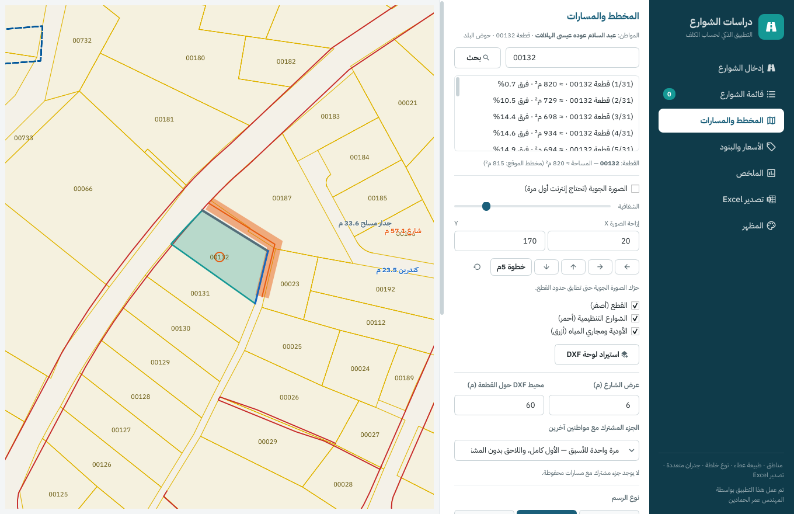
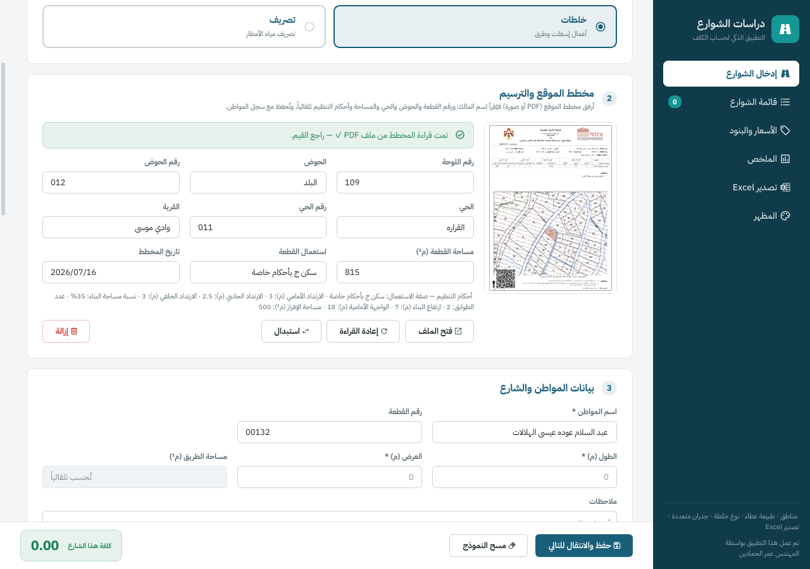
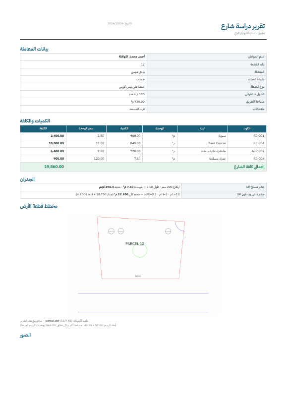
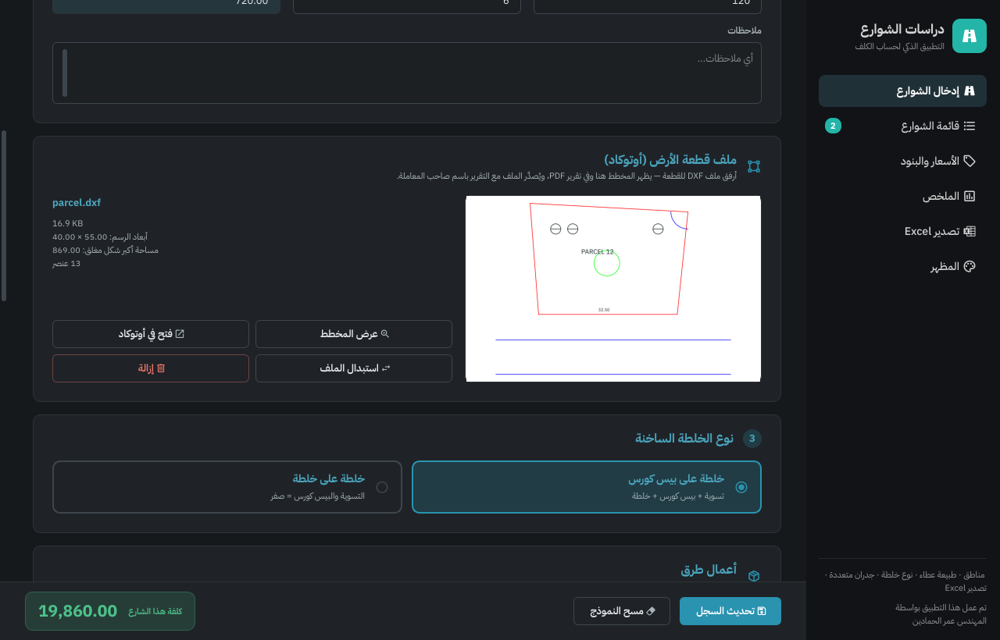
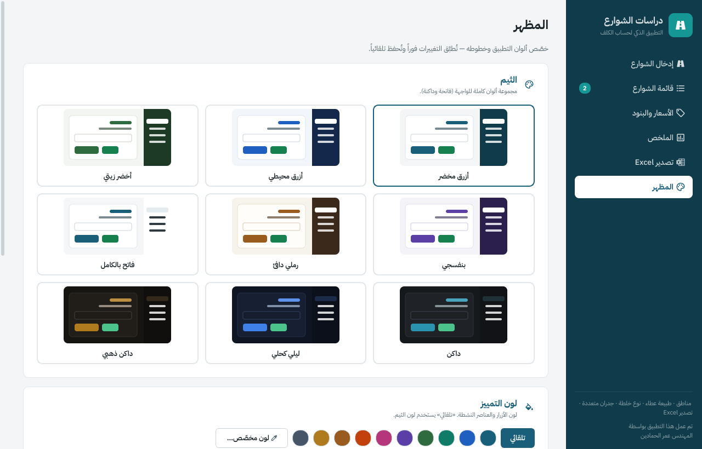

# تطبيق دراسات الشوارع الذكي — نسخة سطح المكتب (Windows)

تطبيق ويندوز لحساب كلف دراسات الشوارع: مناطق · طبيعة عطاء · نوع خلطة · جدران متعددة · ملف أوتوكاد للقطعة ·
مرفقات بدون حد للحجم · تقارير PDF باسم صاحب المعاملة · تصدير Excel · ثيمات وخطوط قابلة للتخصيص.

تم عمل هذا التطبيق بواسطة **المهندس عمر الحمادين**.



## التنزيل والتثبيت

1. نزّل آخر نسخة مباشرة: https://github.com/essamnawafleh-oss/-/releases/latest/download/StreetStudies-Setup.exe
2. شغّل الملف.
3. يضع المُثبّت أيقونة **«دراسات الشوارع»** على سطح المكتب وفي قائمة ابدأ (ولا يحتاج صلاحيات مدير).

> عند أول تشغيل قد يظهر تحذير Windows SmartScreen لأن البرنامج غير موقّع رقمياً:
> اضغط **More info** ثم **Run anyway**.

يوجد أيضاً `StreetStudies-Portable-x.y.z.zip` للتشغيل بدون تثبيت (فك الضغط وشغّل `StreetStudies.exe`).

## أين تُحفظ البيانات؟

في `%APPDATA%\StreetStudies` (ملف `data.json`، إعدادات المظهر `settings.json`، ومجلد `attachments` للصور والمرفقات وملفات القطع).
من صفحة **تصدير Excel** يمكنك حفظ **نسخة احتياطية** (ملف zip) واستعادتها على أي جهاز.

## الصفحات

| الصفحة | الوظيفة |
|---|---|
| إدخال الشوارع | المنطقة، طبيعة العطاء، بيانات المواطن والشارع، نوع الخلطة، الكميات، الجدران، المرفقات، والكلفة الحية |
| قائمة الشوارع | تصفية حسب المنطقة والعطاء، تعديل (نقر مزدوج) وحذف |
| الأسعار والبنود | سعر الوحدة لكل بند — يُحفظ فوراً |
| الملخص | الإجماليات حسب المجموعة والبند |
| تصدير Excel | ملف xlsx بمعادلات حيّة، تقارير PDF لكل المعاملات المعروضة، والنسخ الاحتياطي |
| المظهر | 9 ثيمات (فاتحة وداكنة)، لون تمييز مخصّص، 6 خطوط عربية مرفقة + خطوط الجهاز، حجم الخط، شكل الزوايا |

## مخطط الموقع والترسيم

أرفق «مخطط موقع وترسيم» (PDF من بوابة الخدمات الإلكترونية، أو صورة/مسح ضوئي) في القسم 2 من صفحة الإدخال، فيُقرأ تلقائياً:
اسم المالك، رقم القطعة، رقم اللوحة، الحوض ورقمه، الحي ورقمه، القرية، مساحة القطعة، استعمال القطعة، تاريخ المخطط،
وجدول أحكام التنظيم (الارتدادات، نسبة البناء، عدد الطوابق، الارتفاع، الواجهة، مساحة الإفراز).

- ملفات PDF الرقمية تُقرأ بدقة كاملة. الصور تُقرأ بـ OCR (Tesseract مضمّن مع البرنامج) — راجع القيم قبل الحفظ.
- كل الحقول قابلة للتعديل، وتُحفظ مع سجل المواطن وتظهر في القائمة والتقرير وملف Excel.
- إذا كان المواطن أو القطعة (نفس الرقم والحوض) محفوظاً من قبل، يسألك البرنامج: **تحديث السجل الموجود** (تُضاف المعلومات
  الجديدة مع الإبقاء على المحفوظ سابقاً) أو **سجل جديد**.



## المخطط والمسارات

- المخطط التنظيمي لوادي موسى مضمّن (قطع، شوارع تنظيمية، أودية) ويعمل بدون إنترنت. بحث برقم القطعة، وعند تكرار الرقم
  بين الأحواض تُرتَّب النتائج حسب قرب المساحة من مخطط الموقع.
- الصورة الجوية (Esri) مع الشفافية ومعايرة الإزاحة X/Y — تُحفظ البلاطات على الجهاز فتعمل لاحقاً بدون إنترنت للمناطق التي فُتحت.
- أنواع الرسم: شارع، خط (م.ط)، نقاط (عدد)، مساحة (م²)، جدار دبش، جدار مسلح — مع التقاط تلقائي (OSNAP)، وتراجع،
  وأكثر من خط لنفس المواطن. الزر الأيمن أو النقر المزدوج يثبّت الخط.
- الجزء المشترك مع مسارات مواطنين آخرين: مرة واحدة للأسبق (افتراضي)، غير المشترك فقط، تقسيم بالتساوي، أو كامل.
- «حفظ وربط الكميات بالنموذج» يعبّئ الطول والعرض وكميات البنود والجدران تلقائياً، ويُصدَّر ملف DXF للمسار مع المحيط.
- «استيراد لوحة DXF» يضيف أي لوحة أو منطقة جديدة (بإحداثيات JTM).

## الكنتور والبروفايل الطولي

- في صفحة المخطط: «إرفاق كنتور DXF» — ملف مقصوص حول القطعة والشارع (خطوط ثلاثية الأبعاد بمناسيب Z) بأي فاصل؛
  يُكتشف الفاصل تلقائياً ويمكن تعديله، وتظهر خطوط الكنتور على الخريطة.
- «البروفايل الطولي للشارع»: ميل الأرض لكل مقطع (افتراضياً كل 5 م) مع تمييز المقاطع التي تتجاوز 19%، والمنسوب
  التصميمي الأقل حفراً وردماً بحيث لا يتجاوز الميل 19% ولا القطع/الردم على واجهتي الشارع 4 م (القيم قابلة للتعديل).
  إذا كان المسار نفسه لا يسمح بتحقيق الحد يوضّح البرنامج الطول اللازم لتعديل المسار.
- «تطبيق الحفر والردم» ينقل الكميات إلى بندي الحفر والردم، ويظهر البروفايل في تقرير PDF ويُصدَّر ملف الكنتور مع التقرير.

## الصرف الصحي ودخلات الخدمات

- «فحص الصرف الصحي ودخلات الخدمات» في صفحة المخطط: لكل قطعة مطلة على الشارع المرسوم تُحسب أوطأ نقطة فيها من الكنتور،
  وتُفحص الوصلة المنزلية بالجاذبية إلى خط المجاري في محور الشارع (المنسوب التصميمي − عمق الخط).
- النتيجة لكل قطعة: مخدومة · مخدومة بتعميق الخط (مع العمق المطلوب) · تحتاج دخلة خدمات (مقترحة إلى أقرب شارع أو وادٍ أوطأ)
  · بلا مصرف قريب. كل الافتراضات قابلة للتعديل (عمق الخط، أقصى عمق، ميل الوصلة، عمق بدايتها، عرض الدخلة، مدى البحث).
- النتائج ملوّنة على المخطط، وتظهر في التقرير، وتُصدَّر في DXF بطبقات منفصلة («دخلة خدمات»، «قطع مخدومة بالصرف»…).

## تجمع مياه الأمطار والأودية

- «تجمع الأمطار والأودية» في صفحة المخطط: نموذج ارتفاعات من الكنتور مع اتجاه الجريان والمساحات الصابة.
- نقاط تجمع الأمطار = أوطأ نقاط البروفايل الطولي للشارع؛ لكل نقطة مساحتها الصابة وتدفقها، ومسار الجريان منها حتى أقرب
  وادٍ أو شارع (دخلة تصريف) مع قناة مقترحة.
- الأودية المقترحة تُستخرج من الكنتور حيث تتجاوز المساحة الصابة حداً (افتراضياً 2 هكتار)، ولكل وادٍ مقطع ثابت محسوب من
  تدفقه عند المصب (الطريقة العقلانية + ماننغ)، مع تنبيه عند السرعات العالية (تلزم مساقط).
- المعاملات قابلة للتعديل (C، شدة المطر، حد المساحة، n، أقصى سرعة)، والنتائج على المخطط وفي التقرير وفي DXF.

## الإفراز

- «الإفراز» في صفحة المخطط للقطعة المحددة، بطريقتين:
  - **اقتراح تلقائي:** تقسيم على طول الشارع بحيث تحقق كل قطعة أقل واجهة وأقل مساحة (تُؤخذ من أحكام التنظيم في مخطط
    الموقع إن وُجدت)، ومع القطع العميقة شوارع داخلية بعرض محدد وشارع وصول، وصفوف تطل عليها.
  - **فحص قطع مرسومة:** أداة رسم جديدة «إفراز» لرسم القطع يدوياً ثم فحصها.
- الفحص لكل قطعة: المساحة، الواجهة، والصرف الصحي من الشارع؛ وللشوارع الداخلية: الميل ≤ 19% والقطع/الردم ≤ 4 م.
- القطع المطابقة بالأخضر والمخالفة بالأحمر مع السبب، وتظهر في التقرير وفي DXF («قطع مفروزة»، «شوارع داخلية»).

## ملف قطعة الأرض (أوتوكاد) والتقارير

- في صفحة الإدخال أرفق ملف **DXF** للقطعة (أو اسحبه وأفلته) — تظهر معاينة للمخطط مع أبعاده.
  ملفات DWG تُرفق وتُصدَّر أيضاً، لكن المعاينة لملفات DXF فقط (من أوتوكاد: Save As ← DXF).
- من **قائمة الشوارع** اضغط **تقرير** بجانب أي معاملة، أو من صفحة التصدير «تقارير PDF للمعاملات المعروضة».
  يُنشأ مجلد باسم صاحب المعاملة (مثل `أحمد محمد - قطعة 12`) يحتوي:
  - `أحمد محمد.pdf` — التقرير: البيانات، الكميات والكلفة، الجدران، رسم القطعة، والصور
  - `أحمد محمد.xlsx` — ملف Excel للمعاملة
  - `أحمد محمد - مخطط القطعة.dxf` — ملف الأوتوكاد
  - `أحمد محمد - مخطط الموقع.pdf` و `أحمد محمد - المسار.dxf` — مخطط الموقع وملف المسار المرسوم
  - باقي المرفقات بأسماء تبدأ باسم صاحب المعاملة

| التقرير | الثيم الداكن | صفحة المظهر |
|---|---|---|
|  |  |  |

**الحسابات التلقائية:** التسوية = (العرض + 2) × الطول · البيس كورس = (العرض + 1) × الطول · الخلطة = العرض × الطول
(في «خلطة على خلطة» التسوية والبيس = صفر). الجدران المسلحة من جدول الارتفاعات، وجدار الدبش:
`حجم الجدار = L × H × (0.25 + H/3) / 2` و `حجم القاعدة = L × (H/3 + 0.40) × hb`.

## للمطورين

```bash
pip install -r requirements.txt
python run.py
```

البناء على ويندوز: `build.bat` (يتطلب Inno Setup 6 لإنشاء المُثبّت).
البناء التلقائي: كل دفع إلى `main` يبني التطبيق عبر GitHub Actions، وكل وسم `v*` (مثل `v1.0.1`) ينشر Release جديداً.

```
street_studies/
  app.py            نقطة التشغيل
  main_window.py    النافذة والشريط الجانبي
  data.py           البنود، الجداول، الحسابات، التخزين
  excel_export.py   تصدير Excel
  theme.py          الألوان والخطوط وورقة الأنماط
  widgets.py        عناصر مشتركة
  pages/            صفحات التطبيق
  report.py         تقرير PDF ومجلد التصدير باسم صاحب المعاملة
  dxf_render.py     قراءة ورسم ملفات DXF (مكتبة ezdxf)
  site_plan.py      قراءة مخطط الموقع والترسيم (PyMuPDF + Tesseract OCR)
  geo.py            بيانات المخطط التنظيمي، الفهرس المكاني، تحويل JTM ↔ WGS84، استيراد لوحات DXF
  map_canvas.py     لوحة الخريطة والصورة الجوية والالتقاط
  dxf_export.py     ملف DXF لمسار المواطن
  settings.py       إعدادات المظهر
  assets/           الأيقونة، مخططات الجدران، الخطوط العربية (رخصة SIL OFL)
```
