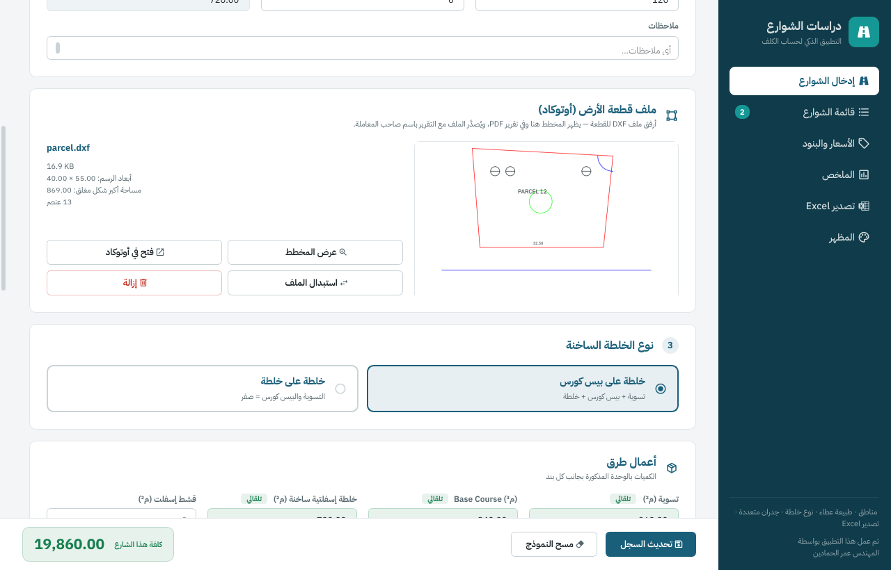
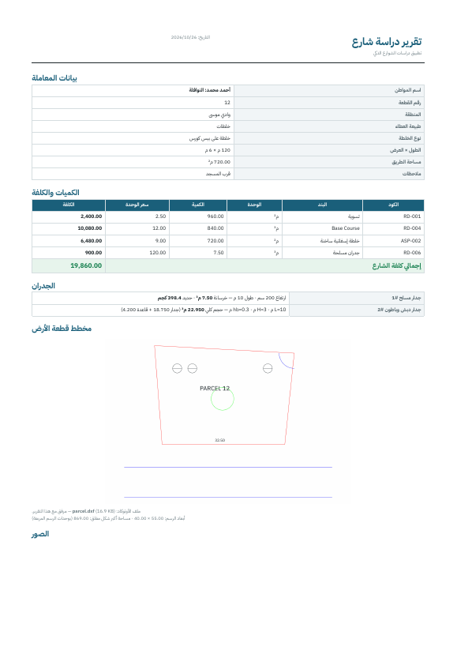
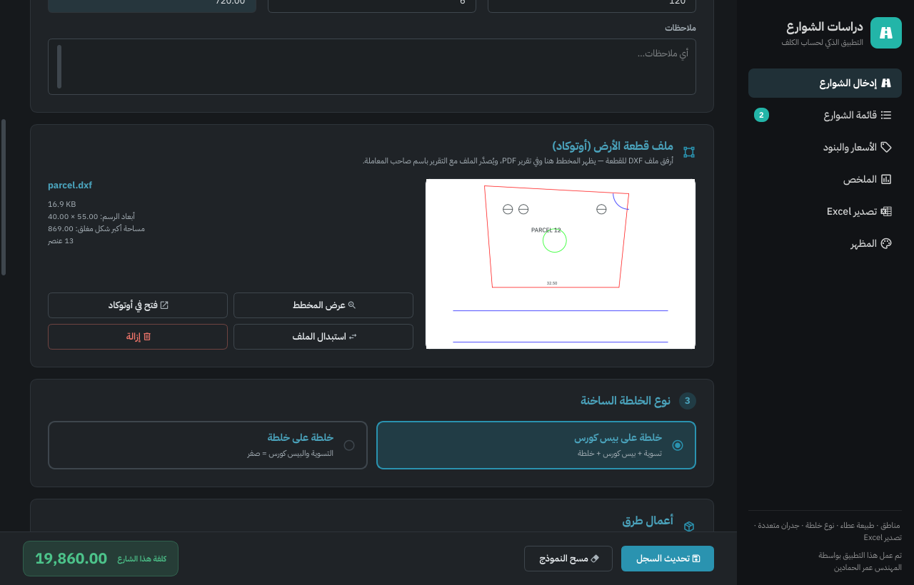
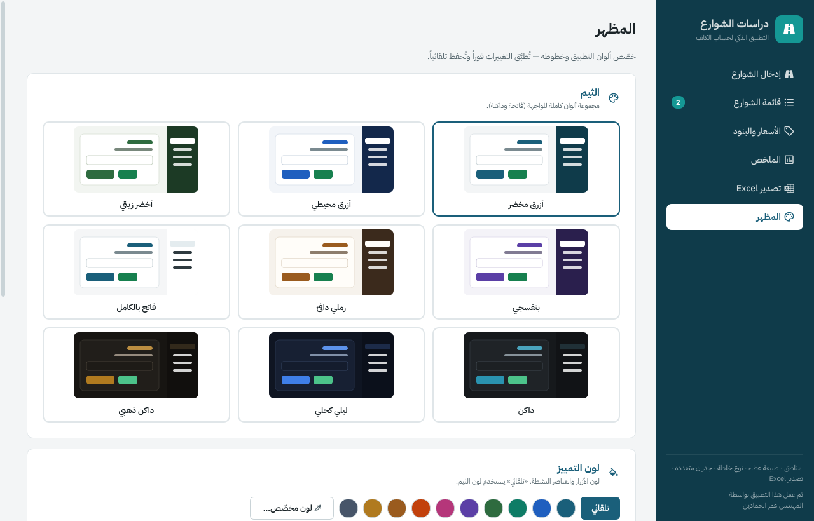

# تطبيق دراسات الشوارع الذكي — نسخة سطح المكتب (Windows)

تطبيق ويندوز لحساب كلف دراسات الشوارع: مناطق · طبيعة عطاء · نوع خلطة · جدران متعددة · ملف أوتوكاد للقطعة ·
مرفقات بدون حد للحجم · تقارير PDF باسم صاحب المعاملة · تصدير Excel · ثيمات وخطوط قابلة للتخصيص.

تم عمل هذا التطبيق بواسطة **المهندس عمر الحمادين**.



## التنزيل والتثبيت

1. افتح صفحة **Releases** في هذا المستودع.
2. نزّل `StreetStudies-Setup-x.y.z.exe` وشغّله.
3. يضع المُثبّت أيقونة **«دراسات الشوارع»** على سطح المكتب وفي قائمة ابدأ (ولا يحتاج صلاحيات مدير).

> عند أول تشغيل قد يظهر تحذير Windows SmartScreen لأن البرنامج غير موقّع رقمياً:
> اضغط **More info** ثم **Run anyway**.

يوجد أيضاً `StreetStudies-Portable-x.y.z.zip` للتشغيل بدون تثبيت (فك الضغط وشغّل `StreetStudies.exe`).

## أين تُحفظ البيانات؟

في `%APPDATA%\StreetStudies` (ملف `data.json`، إعدادات المظهر `settings.json`، ومجلد `attachments` للصور والمرفقات وملفات القطع).
من صفحة **تصدير Excel** يمكنك حفظ **نسخة احتياطية** (ملف zip) واستعادتها على أي جهاز.

## الصفحات

| الصفحة | الوظيفة |
|---|---|
| إدخال الشوارع | المنطقة، طبيعة العطاء، بيانات المواطن والشارع، نوع الخلطة، الكميات، الجدران، المرفقات، والكلفة الحية |
| قائمة الشوارع | تصفية حسب المنطقة والعطاء، تعديل (نقر مزدوج) وحذف |
| الأسعار والبنود | سعر الوحدة لكل بند — يُحفظ فوراً |
| الملخص | الإجماليات حسب المجموعة والبند |
| تصدير Excel | ملف xlsx بمعادلات حيّة، تقارير PDF لكل المعاملات المعروضة، والنسخ الاحتياطي |
| المظهر | 9 ثيمات (فاتحة وداكنة)، لون تمييز مخصّص، 6 خطوط عربية مرفقة + خطوط الجهاز، حجم الخط، شكل الزوايا |

## ملف قطعة الأرض (أوتوكاد) والتقارير

- في صفحة الإدخال أرفق ملف **DXF** للقطعة (أو اسحبه وأفلته) — تظهر معاينة للمخطط مع أبعاده.
  ملفات DWG تُرفق وتُصدَّر أيضاً، لكن المعاينة لملفات DXF فقط (من أوتوكاد: Save As ← DXF).
- من **قائمة الشوارع** اضغط **تقرير** بجانب أي معاملة، أو من صفحة التصدير «تقارير PDF للمعاملات المعروضة».
  يُنشأ مجلد باسم صاحب المعاملة (مثل `أحمد محمد - قطعة 12`) يحتوي:
  - `أحمد محمد.pdf` — التقرير: البيانات، الكميات والكلفة، الجدران، رسم القطعة، والصور
  - `أحمد محمد.xlsx` — ملف Excel للمعاملة
  - `أحمد محمد - مخطط القطعة.dxf` — ملف الأوتوكاد
  - باقي المرفقات بأسماء تبدأ باسم صاحب المعاملة

| التقرير | الثيم الداكن | صفحة المظهر |
|---|---|---|
|  |  |  |

**الحسابات التلقائية:** التسوية = (العرض + 2) × الطول · البيس كورس = (العرض + 1) × الطول · الخلطة = العرض × الطول
(في «خلطة على خلطة» التسوية والبيس = صفر). الجدران المسلحة من جدول الارتفاعات، وجدار الدبش:
`حجم الجدار = L × H × (0.25 + H/3) / 2` و `حجم القاعدة = L × (H/3 + 0.40) × hb`.

## للمطورين

```bash
pip install -r requirements.txt
python run.py
```

البناء على ويندوز: `build.bat` (يتطلب Inno Setup 6 لإنشاء المُثبّت).
البناء التلقائي: كل دفع إلى `main` يبني التطبيق عبر GitHub Actions، وكل وسم `v*` (مثل `v1.0.1`) ينشر Release جديداً.

```
street_studies/
  app.py            نقطة التشغيل
  main_window.py    النافذة والشريط الجانبي
  data.py           البنود، الجداول، الحسابات، التخزين
  excel_export.py   تصدير Excel
  theme.py          الألوان والخطوط وورقة الأنماط
  widgets.py        عناصر مشتركة
  pages/            صفحات التطبيق
  report.py         تقرير PDF ومجلد التصدير باسم صاحب المعاملة
  dxf_render.py     قراءة ورسم ملفات DXF (مكتبة ezdxf)
  settings.py       إعدادات المظهر
  assets/           الأيقونة، مخططات الجدران، الخطوط العربية (رخصة SIL OFL)
```
